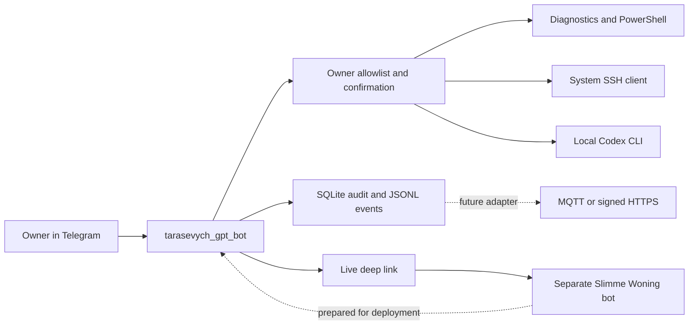

# Architecture

The bot uses Telegram Bot API long polling and exposes no inbound network port. Operations run in the owner's interactive Windows session so Windows Credential Manager, SSH keys, and the existing Codex login remain available.

Key boundaries:

1. Authorization precedes command routing.
2. Group chats are rejected even when the owner sent the message.
3. Arbitrary local commands are separated from read-only diagnostics and require a fresh callback confirmation.
4. Codex does not receive `danger-full-access`; the default is `workspace-write`. Approval policy `never` fails closed instead of waiting for an unavailable interactive prompt.
5. SSH is an outbound client with `BatchMode=yes`, not a public SSH server on this PC.
6. Telegram bots do not receive other bots' messages. Smart-home cooperation therefore uses deep links and a separate event contract.

The event contract carries `opstart_id`, monotonic `volgnummer`, random `bericht_id`, timestamp, actor, function, action, target, and status. Status values match the home-core contract: `ontvangen`, `aanvaard`, `uitgevoerd`, `geweigerd`, `mislukt`, `verlopen`, and `onzeker`.
