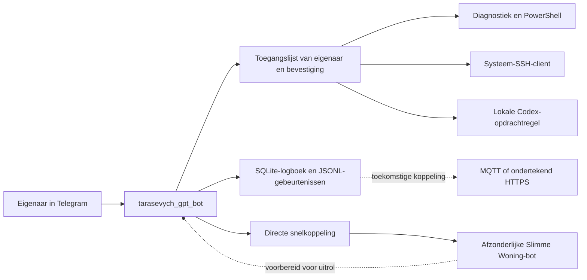

# Architectuur en systeemgrenzen

**Taal:** Nederlands | [Українська (Oekraïens)](../uk/архітектура.md) | [Nederlands overzicht (LEESMIJ.nl.md)](../../LEESMIJ.nl.md) | [Hoofdpagina (README.md)](../../README.md)

De bot maakt gebruik van de Telegram Bot-interface via langdurige opvraging en opent geen enkele inkomende netwerkpoort op de computer. Alle handelingen worden uitgevoerd binnen de interactieve Windows-sessie van de eigenaar, waardoor het Windows-referentiebeheer, de SSH-sleutels en de bestaande Codex-aanmelding direct beschikbaar blijven.

## Belangrijkste veiligheids- en systeemgrenzen

1. De controle van de eigenaarsrechten vindt altijd plaats vóór de verwerking van een opdracht.
2. Groepsgesprekken worden onvoorwaardelijk geweigerd, zelfs wanneer het bericht door de eigenaar zelf is verzonden.
3. Vrije lokale opdrachten zijn strikt gescheiden van uitleesroutes voor diagnostiek en vereisen een verse bevestiging via een drukknop.
4. Codex krijgt nooit onbeperkte systeemtoegang (`danger-full-access`); de standaardinstelling is schrijfbevoegdheid binnen de werkmap (`workspace-write`), en het goedkeuringsbeleid `never` weigert veilig in plaats van te wachten op een onzichtbaar dialoogvenster.
5. SSH functioneert uitsluitend als uitgaande client met `BatchMode=yes` en niet als een openbare SSH-server op deze pc.
6. Telegram-bots ontvangen geen berichten van andere bots. Samenwerking met het slimme-woningsysteem verloopt daarom via directe snelkoppelingen en een afzonderlijk gebeurteniscontract.

## Het gebeurteniscontract

Het gebeurteniscontract bevat `opstart_id`, een oplopend `volgnummer`, een willekeurig `bericht_id`, het tijdstip, de uitvoerder, de functie, de actie, het doel en de status. De statuswaarden komen exact overeen met het kernsysteem van de slimme woning: `ontvangen`, `aanvaard`, `uitgevoerd`, `geweigerd`, `mislukt`, `verlopen` en `onzeker`.

## Overige documentatie

- [Installatie en configuratie](installatie.md)
- [Beveiliging en privégegevens](veiligheid.md)
- [SSH-verbindingen en externe apparaten](ssh.md)
- [Codex GPT](codex.md)
- [Koppeling met Slimme Woning](slimme-woning.md)
- [Herstel en controle](herstel.md)
- [Huidige acceptatiestatus](status.md)
