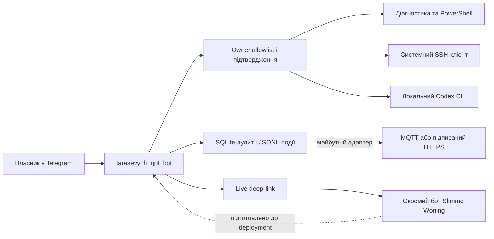

# Архітектура

Бот використовує Telegram Bot API через long polling і не відкриває вхідний мережевий порт. Всі операції виконуються в інтерактивному Windows-сеансі власника, тому доступні його Credential Manager, SSH-ключі та Codex-авторизація.

Ключові межі:

1. Авторизація відбувається до маршрутизації команди.
2. Групові чати відхиляються, навіть якщо повідомлення надіслав власник.
3. Довільна локальна команда відділена від діагностичних read-only маршрутів і потребує callback-підтвердження.
4. Codex не отримує `danger-full-access`; типовий режим — `workspace-write`, approvals `never` означає fail-closed замість очікування недоступного діалогу.
5. SSH — вихідний клієнт із `BatchMode=yes`, а не публічний SSH-сервер цього ПК.
6. Боти Telegram не отримують повідомлень від інших ботів. Взаємодія з розумним будинком відбувається через deep-link та окремий подієвий контракт.

Подієвий контракт містить `opstart_id`, монотонний `volgnummer`, випадковий `bericht_id`, час, актора, функцію, дію, ціль і статус. Статуси узгоджені з ядром будинку: `ontvangen`, `aanvaard`, `uitgevoerd`, `geweigerd`, `mislukt`, `verlopen`, `onzeker`.
