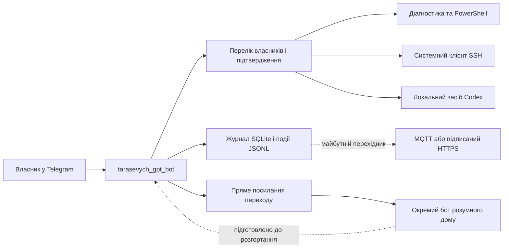

# Архітектура та межі системи

**Мова:** Українська | [Nederlands (Нідерландська)](../nl/architectuur.md) | [Український огляд (README.uk.md)](../../README.uk.md) | [На головну (README.md)](../../README.md)

Бот взаємодіє з програмним інтерфейсом Telegram через тривале опитування і не відкриває жодного вхідного мережевого порту на комп'ютері. Усі дії виконуються в користувацькому сеансі власника у Windows, завдяки чому залишаються доступними системне сховище облікових даних Windows, ключі SSH та наявний вхід до середовища Codex.

## Основні межі безпеки та роботи

1. Перевірка повноважень власника завжди виконується до маршрутизації будь-якої команди.
2. Повідомлення з групових бесід безумовно відхиляються, навіть якщо їх надіслав сам власник.
3. Довільна локальна команда відокремлена від безпечних оглядових маршрутів (які працюють лише на читання) і вимагає окремого підтвердження кнопкою.
4. Засіб Codex ніколи не отримує необмеженого доступу `danger-full-access`; типовим режимом є робота лише в межах робочої теки (`workspace-write`), а політика запитів на підтвердження `never` забезпечує безпечну відмову замість нескінченного очікування невидимого вікна.
5. З'єднання SSH працює виключно як вихідний клієнт із параметром `BatchMode=yes`, а не як відкритий сервер SSH на цьому комп'ютері.
6. Боти в мережі Telegram не можуть напряму обмінюватися повідомленнями між собою. Тому взаємодія з системою розумного дому побудована через прямі посилання переходу та окремий узгоджений договір подій.

## Договір обміну подіями

Запис події містить ідентифікатор запуску `opstart_id`, послідовний порядковий номер `volgnummer`, випадковий ідентифікатор повідомлення `bericht_id`, позначку часу, виконавця, назву функції, дію, ціль і стан виконання. Перелік станів повністю узгоджений із ядром розумного дому: `ontvangen` (отримано), `aanvaard` (прийнято), `uitgevoerd` (виконано), `geweigerd` (відхилено), `mislukt` (помилка), `verlopen` (час вичерпано), `onzeker` (невизначено).

## Інші розділи документації

- [Встановлення і налаштування](встановлення.md)
- [Безпека і приватні дані](безпека.md)
- [Захищене з'єднання SSH](захищене-зєднання-ssh.md)
- [Кодекс ШІ (Codex GPT)](кодекс-ші.md)
- [Розумний дім](розумний-дім.md)
- [Відновлення й перевірка](відновлення.md)
- [Поточний стан приймання](стан.md)
